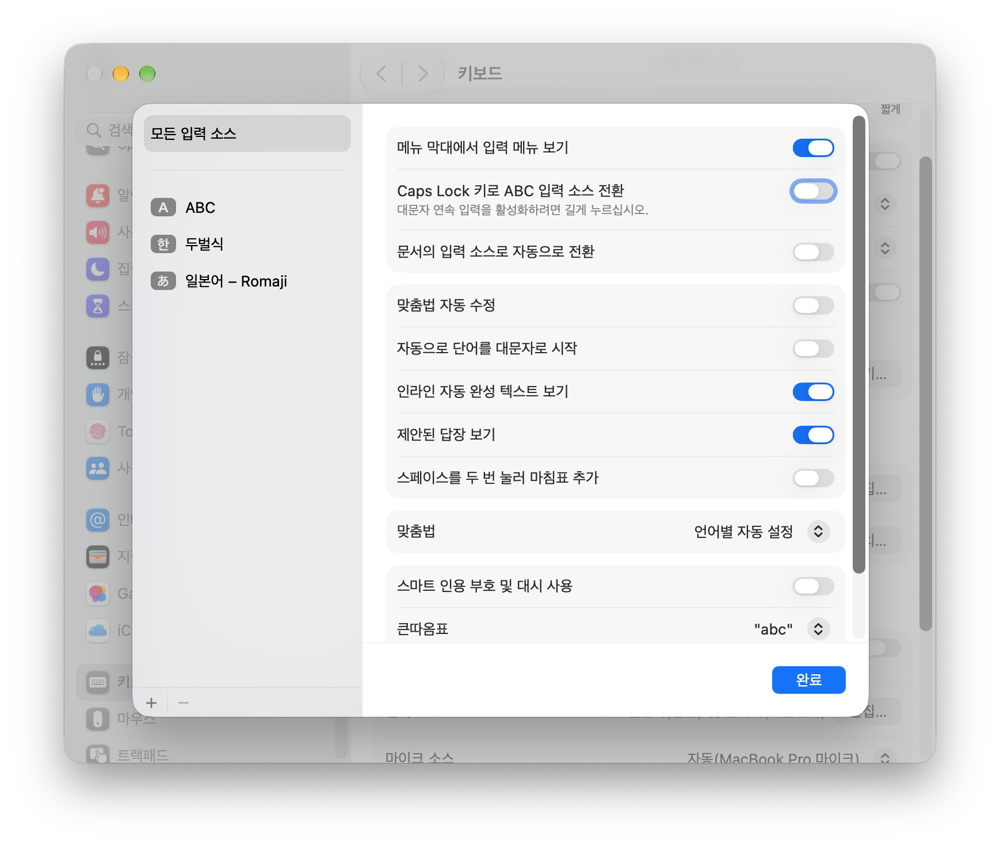
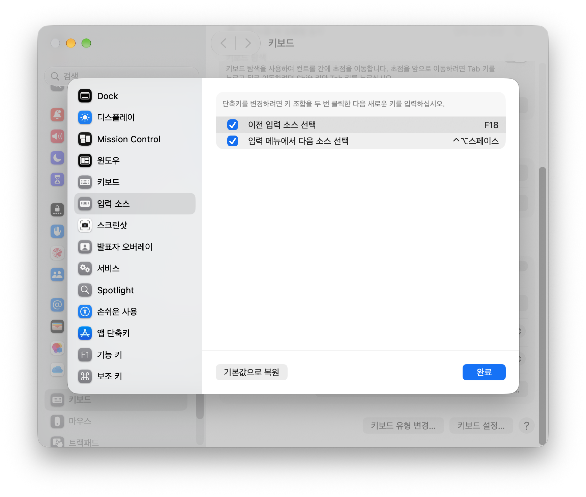

# Caps Switch

Caps Lock을 F13~F20 중 선택한 키로 변경하고 Shift+Caps Lock으로 대문자 잠금을 토글하는 macOS 메뉴 막대 앱이다. 기본값은 F18이며 macOS 14 이상에서 실행한다.

손쉬운 사용·입력 모니터링·관리자 권한을 요청하지 않는다. 키 입력 전체를 수신하는 이벤트 감시기, 가상 키보드 드라이버, 네트워크 기능, 외부 패키지를 추가하지 않는다. macOS의 키 매핑 API와 Shift+선택한 펑션 키 전역 단축키를 사용한다.

## 빌드와 실행

```sh
cd /Users/seokmin/Documents/personal/caps-switch
zsh scripts/build-app.sh
open '/Users/seokmin/Documents/personal/caps-switch/build/Caps Switch.app'
```

앱은 설정 창을 열지 않고 메뉴 막대의 ‘⇪’ 아이콘으로 실행한다. 아이콘의 ‘설정…’을 선택하거나 실행 중인 앱을 다시 열면 설정 창을 표시한다. Caps Lock에 지정할 키를 선택하고 ‘Caps Lock 전환 사용 시작’을 누른다. 첫 실행에는 키 매핑을 변경하지 않는다. 이후 실행에는 저장한 키와 사용 상태를 복원한다. 키를 변경하면 기존 매핑을 복원하고 사용을 중지하므로 새 키로 사용하려면 다시 시작한다.

## 언어 전환 설정

앱의 ‘키보드 설정 열기’ 버튼으로 macOS 설정을 연다. 키보드 → 텍스트 입력 → 편집… → 모든 입력 소스에서 ‘Caps Lock 키로 ABC 입력 소스 전환’을 비활성화하고 ‘완료’를 클릭한다. 아래 화면에서 해당 스위치가 비활성화된 상태를 확인할 수 있다.



키보드 → 키보드 단축키… → 입력 소스에서 ‘이전 입력 소스 선택’을 활성화한다. 키 조합을 두 번 클릭한 다음 Caps Lock을 눌러 선택한 펑션 키로 등록하고 ‘완료’를 클릭한다. 아래 화면은 F18로 등록한 예시다. ‘입력 메뉴에서 다음 소스 선택’과 구분해서 설정한다.



앱은 언어 전환 설정을 안내하고 선택한 키의 등록 상태를 조회한다. macOS의 비공개 설정 형식에는 값을 기록하지 않는다. 한글과 영어만 등록하면 선택한 키로 두 입력 소스를 전환할 수 있다. 매크로를 실행하는 앱에서도 선택한 펑션 키를 단축키로 등록할 수 있다. Caps Switch 자체는 매크로 실행기를 제공하지 않는다.

## 실행과 복원

다른 앱으로 이동하면 설정 창을 자동으로 닫고 창과 안내 이미지의 참조를 해제한다. 다시 설정을 열 때 창과 이미지를 생성한다. 로그인 시 자동 실행에도 설정 창을 표시하지 않는다.

설정 창을 닫아도 앱은 메뉴 막대에서 계속 실행한다. ‘사용 중지’하거나 앱을 정상 종료하면 Caps Lock의 이전 매핑을 복원한다. 다른 키의 매핑은 보존한다. 전환 사용 중에는 절전·화면 복귀, 사용자 세션 복귀, 키보드 서비스 연결 변경 알림으로 매핑을 복구한다. 계속 반복하는 조회 타이머는 실행하지 않는다. 복귀 직후 키보드가 준비되지 않은 경우를 위해 알림마다 제한된 횟수로 확인한다. 사용 중지 상태에서는 적용하지 않으며 다른 앱이 지정한 Caps Lock 매핑은 자동 복구로 덮어쓰지 않는다.

화면 잠금 해제 시에는 `com.apple.screenIsUnlocked` 알림도 참조한다. Apple이 공개 명세로 보장하는 알림은 아니므로 macOS 버전에 따라 이 알림을 받지 못할 수 있다. 절전·화면 복귀와 사용자 세션 복귀, 키보드 서비스 연결 알림은 별도로 처리한다.

Shift+Caps Lock 토글은 앱이 실행 중일 때 동작한다. 정상 종료와 SIGTERM·SIGINT 종료 요청에는 매핑을 복원한다. 키보드 하나의 복원이 실패해도 나머지 키보드는 계속 복원하고 실패한 키보드의 원래 값을 보존한다. 복원 실패 시 종료를 취소하므로 사용 중지 버튼이나 종료 메뉴로 다시 시도할 수 있다. 다른 앱이 변경한 Caps Lock 매핑은 유지한다.

SIGKILL 강제 종료나 프로세스 충돌에는 종료 코드를 실행할 수 없으므로 키 매핑이 남을 수 있으며 재부팅하면 사라진다. 별도의 복원용 상주 프로세스는 실행하지 않는다. macOS에서 등록한 언어 전환 단축키는 앱 종료 후에도 유지한다.

‘로그인 시 자동 실행’을 선택하면 `SMAppService.mainApp`으로 로그인 항목을 등록한다. macOS가 승인을 요구하면 로그인 항목 설정 화면을 연다. 선택을 해제하면 등록을 취소한다. 앱 종료는 자동 실행 등록을 취소하지 않는다. [Apple 로그인 항목 API](https://developer.apple.com/documentation/servicemanagement/smappservice/mainapp)

## Homebrew 배포

빌드 결과는 Homebrew Cask의 `app "Caps Switch.app"` 항목으로 설치할 수 있는 앱 번들이다. 배포할 때 버전별 ZIP 또는 DMG를 게시하고 다운로드 URL, SHA-256, 버전, 앱 이름을 지정하는 Cask를 개인 tap에 등록한다. 공식 저장소 등록에는 별도의 심사 조건이 있다. [Homebrew Cask Cookbook](https://docs.brew.sh/Cask-Cookbook)

현재 빌드 스크립트는 로컬 실행용 ad hoc 서명을 사용한다. 외부 배포에는 Developer ID 서명과 공증을 준비하고 지원할 CPU 아키텍처별로 빌드한다. 이 프로젝트에는 tap 등록과 릴리스 게시를 수행하는 설정을 추가하지 않는다.

## 검증

```sh
xcrun swift test --jobs 2
xcrun swift-format lint --strict --recursive Package.swift sources tests
'build/Caps Switch.app/Contents/MacOS/CapsSwitch' --verify
```

`--verify`는 연결된 키보드에 Caps Lock → F18을 일시 적용한 뒤 조회하고, 대문자 잠금 상태를 변경한 뒤 원래 상태로 복원한다. Shift+F18 등록·해제도 확인한다. 물리 키 입력과 입력 소스 전환은 앱의 설정을 마친 뒤 직접 확인한다.

## 참고 자료

- [Apple TN2450: 키 매핑 API](https://developer.apple.com/library/archive/technotes/tn2450/)
- [Apple IOHIDSetModifierLockState](https://developer.apple.com/documentation/iokit/1555420-iohidsetmodifierlockstate)
